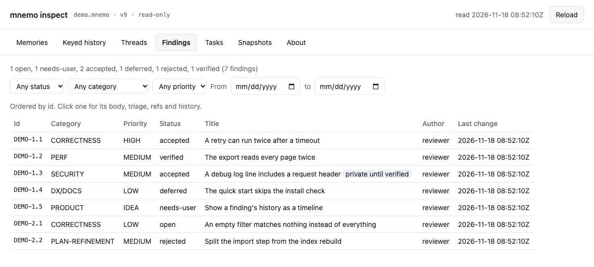

# Memory Nemo (MNemo)

[](https://github.com/toarchkumar/mnemo/actions/workflows/ci.yml)
[](https://pypi.org/project/mnemo-engine/)
[](https://crates.io/crates/mnemo-engine)
[](LICENSE)

**Shared memory for your coding agents, in one encrypted file. Written in Rust.**

MNemo doesn't compete with vector databases. It competes with `CLAUDE.md`
and a notes folder. It's a project's memory that every session can search,
that several agents can share their work through, and that you can open
and read. It's one encrypted `.mnemo` file inside `.git`, with no server
and no account, and it's free.

```sh
curl -fsSL https://toarchkumar.github.io/mnemo/install.sh | sh
mnemo onboard     # in your repository: shows the plan, asks once
mnemo inspect     # see what your agents remember, in your browser
```

It comes in three layers. Start with the first; the others are there
when you need them.

**1. Memory you can search.**
- **Every session is saved** into its own thread, and searched by meaning
  and keywords together, so "why did we decide X?" is one recall, not
  scrolling. Exact names like `snapshot_list` or `v0.10.0` are found.
- **Facts that change keep their history.** Save a fact under a key, like
  `decision.release-order`, and the new version replaces the old one in
  recall; every version stays in its history.
- **It sets itself up.** `mnemo onboard` wires Claude Code and Cursor: the
  MCP tools, and hooks that brief a new session and save it at the end.
  One brain per repository, shared by every worktree and every client.

**2. Agents sharing work.**
- **Several sessions on one machine coordinate through the same file:** a
  task queue with dependencies, an inbox, claims on files, and review
  findings with their triage. You run the agents; they remember and
  coordinate through MNemo.
- **You can watch it.** `mnemo inspect` shows the memories, the tasks and
  the findings in your browser, read-only. `mnemo export --git` writes a
  backup you can commit and diff.

**3. The engine underneath.**
- **Encrypted and crash-safe.** Every page is sealed with AES-256-GCM;
  commits go through a write-ahead log; recent commits are kept as
  restorable snapshots; OS file locks allow one writer and many readers,
  and shared mode lets several processes use one file in turn. The key is
  generated and kept in the OS keychain, with a recovery code.
- **Small on disk.** About 1.5 KB per memory at 100K memories, about 6 times
  smaller than before v0.11's format: memories share pages, vectors are
  stored at half precision, and saved conversation turns are compressed
  once they're a week old. This repository's own brain holds 18,908
  memories, almost all of them saved session turns, in 33 MB.
- **Local all the way down.** A small built-in model embeds text on your
  CPU; a result cache keeps LLM responses and tool outputs; an MCP server
  is built in.
- **The same engine in your own apps,** from Python, Rust, Swift and
  Kotlin, on desktops and phones.

**When `CLAUDE.md` is enough:** one session on a small project. MNemo pays
off when there are many sessions to remember, or several agents sharing
the work.

Site: **https://toarchkumar.github.io/mnemo/**

**Coming next: encrypted sync** for your brains across your devices and
your team, with a server that never sees your data.
[Join the waitlist](https://forms.gle/zBrWaECk4L7By4Bc6).

## Install

The `mnemo` CLI and MCP server, on macOS and Linux:

```sh
curl -fsSL https://toarchkumar.github.io/mnemo/install.sh | sh
```

On Windows (PowerShell):

```powershell
irm https://toarchkumar.github.io/mnemo/install.ps1 | iex
```

The script downloads the release binary for your platform, checks its
SHA-256 and, when the GitHub CLI (`gh`) is signed in, the build's
attestation, then installs it to `~/.local/bin` (or
`%LOCALAPPDATA%\Programs\mnemo`) without sudo. To read it before running
it, download it first. Rust users can run `cargo binstall mnemo-engine`
instead.

The libraries:

```sh
pip install mnemo-engine          # Python (import mnemo_engine)
cargo add mnemo-engine            # Rust library (use mnemo_engine::...)
```

To build the CLI from source, run `cargo install mnemo-engine --features
keychain,embed-candle`. Without those two features it has no OS keychain
and no built-in embedder (the prebuilt binaries and the PyPI wheels have
both). Wheels cover Linux (x86_64, ARM), macOS (Intel, Apple Silicon) and
Windows (x86_64); elsewhere, pip builds from source, without the keychain
and the built-in embedder.

iOS and Android (from v0.12.0; current 0.19.0):

```swift
// Swift Package Manager (Xcode: File > Add Package Dependencies)
.package(url: "https://github.com/toarchkumar/mnemo-swift", from: "0.19.0")
```

```kotlin
// Android, from Maven Central (arm64-v8a and x86_64)
implementation("io.github.toarchkumar:mnemo-android:0.19.0")
```

The package is `mnemo-engine` everywhere, and from v0.7.0 the Python module and
Rust library are `mnemo_engine` too. `mnemo-db` on PyPI and `mnemo` on
crates.io are unrelated projects.

Prebuilt CLI binaries for Linux, macOS and Windows are on the
[Releases](https://github.com/toarchkumar/mnemo/releases) page. The PyPI wheels
and release binaries for Apple Silicon and ARM Linux use the CPU's hardware AES.
If you build from crates.io on ARM yourself, see
[enabling hardware AES](mnemo/README.md).

## Quick start

In a project, for Claude Code or Cursor. Run this in the git repository:

```sh
mnemo onboard
```

It shows what it will write and asks once. It creates the project's brain
under `.git` (so every worktree shares it and git never tracks it), keeps
its key in the OS keychain, installs the built-in model, and wires each
client it finds: the MCP server, the hooks, and a short guide for the
agent. Re-running it repairs what's missing, and `mnemo onboard --undo`
removes what it wrote. `mnemo onboard --guide` prints the guide.

To see what's in it, run `mnemo inspect`. It prints a link to a
read-only page in your browser: search, each fact's history, and your
agents' tasks and review findings. It reads the file once and writes
nothing.



For a file of your own, the CLI. `init` makes a key and keeps it in your OS keychain, and the built-in
embedder fetches its model (91 MB) once, on first use:

```sh
mnemo init agent.mnemo               # a generated key, kept in the keychain
mnemo remember agent.mnemo --text "the user prefers dark mode"
mnemo recall agent.mnemo --text "which theme does the user like?"
```

`mnemo embedder install` fetches the model ahead of time. To use another
model, pass `--embed-cmd` and `--embed-name` (a reference script is in
[`mnemo/examples/embedder_server.py`](mnemo/examples/embedder_server.py)).
`mnemo recovery-code agent.mnemo` shows the code that opens the file on
another machine (`mnemo unlock` there).

Python:

```python
import mnemo_engine

with mnemo_engine.open("agent.mnemo") as db:   # the key comes from the keychain
    db.use_builtin_embedder()
    db.remember_text("the user prefers dark mode", "semantic", importance=0.8)
    for hit in db.recall_text("which theme does the user like?", top_k=5):
        print(round(hit["score"], 3), hit["content"])

    # A fact that changes: the key replaces the old version, and history is kept
    db.remember_text("the current release is v0.19.1", "semantic", key="current-release")
```

To create a file from Python, pass a passphrase and the width:
`mnemo_engine.open("agent.mnemo", "a long passphrase", dimensions=384)`. For
another model, `db.set_embedder(fn, name=..., dimensions=...)`.

MCP, for Claude Code, Cursor or Claude Desktop:

```sh
mnemo embedder install                              # so the first start doesn't wait for the download
mnemo mcp install --client claude-desktop agent.mnemo
```

It adds `mnemo serve --mcp --shared <file>` to the client's config, shows
the change first, and never writes a secret: the server finds the key in
the keychain.

The full Rust API, every CLI command, the cache, the file format, durability
and the security model are documented in [`mnemo/README.md`](mnemo/README.md).
The Python API is in [`mnemo-python/README.md`](mnemo-python/README.md).

## What's new in v0.19.1: a damaged search index repairs itself

- **A damaged search index no longer makes recall fail.** The index is
  rebuilt from your memories, so recall now reads every memory, gets the
  right answer, says once that the index is damaged, and rebuilds it with
  the next write. `mnemo index --rebuild` repairs it at once. Your
  memories were never at risk.
- **`mnemo verify` checks the search index** and reports it on its own
  line (`verify_index()` in Rust and Python).
- The iOS and Android packages stay at 0.19.0, which has the same mobile
  code.

## What's new in v0.19.0: a faster first search

- **The first search after opening is about ten times faster in a large
  brain:** 11.5 ms at 100K memories instead of about 117 ms, and 4.2 ms
  at 10K instead of about 10 ms (an M1 Pro). Opening a 100K file takes
  26 ms instead of 30. Later searches are unchanged, at 2–3 ms.
- **The search index is stored in a new layout,** inside the same v9
  file. An older `mnemo` still opens the file and finds the right
  results, just more slowly on a large one. On a brain with 20,000
  memories or more, upgrade every session's `mnemo` together.
- **`mnemo inspect` has a date range** on its Memories, Findings and
  Tasks tabs, and a link can open a tab (`#findings`).
- **Rust:** the task, message, claim and findings types are
  `#[non_exhaustive]`. Code outside the crate builds them with
  `TaskSpec::new(...)`, `FindingSpec::new(...)` or `Default`, then sets
  fields; a struct expression, even with `..Default::default()`, no
  longer compiles. The [CHANGELOG](CHANGELOG.md) has an example.
- The iOS and Android packages are at 0.19.0, with no API change.

## What's new in v0.18.1: watch your agents' work in the browser

- **`mnemo inspect` shows review findings and tasks,** each in its own
  tab: findings by id with their status, triage and verification, and
  tasks with their owner, what they wait for and their history. Filter
  either by status. The inspector still only reads the file.
- **Tasks have refs:** what a task is about, such as a finding's id, a
  file or a PR (`mnemo task add --ref RB-014.1`, the MCP `task` tool,
  Python's `task_add(refs=...)`).
- **The backup leaves out a task that refs a security finding** until
  that finding is verified, as it already does for the finding.
- **Rust:** `TaskSpec` and `Task` have a new field, `refs`. Code that
  uses `..Default::default()` is unaffected.
- The iOS and Android packages stay at 0.18.0.

## What's new in v0.18.0: review findings in the brain, and a backup you can commit

- **Review findings are records in the brain,** beside tasks and messages.
  A reviewer adds one under an id (`RB-014.1`) with a category, a
  priority, a title and a body; the planner triages it (accepted,
  deferred, rejected or needs-user, with why); a reviewer verifies it.
  Each keeps its history. `mnemo finding add|triage|verify|list|get`,
  the MCP `finding` tool and Python. A planner session is told when
  findings wait for triage.
- **`mnemo export --git` is the brain's backup,** written to be committed:
  facts by key, tasks, findings, then the project's essence. It leaves out
  saved turns, private records, messages, claims, one session's working
  notes, and any security finding until it's verified against a
  released version (until then it's private, so older builds skip it
  too). The file names the build that wrote it, and two exports of an
  unchanged brain are identical. This repository commits its own as
  [`docs/brain.md`](docs/brain.md).
- **Upgrade every session's `mnemo` together:** an older build sees a
  finding as an ordinary fact.
- The iOS and Android packages publish at 0.18.0, with no change to their
  API.

## What's new in v0.17.2: from our own agents' first run

Built while this project's own agents handed their work to each other
through their brain, and shaped by what that run turned up:

- **A task you added tells you when it's ready** for your `done`: once on
  your next turn, and in your session's brief while it waits.
- **A session shows as present from its start** (`mnemo claim who`), not
  only after its first write.
- **The built-in model's download tries again** after a dropped
  connection, a timeout or a server error, and never after a file that
  doesn't match its checksum.
- **Smaller:** `cache` takes no path in a git repository; `mnemo://about`
  shows the counts; `who`'s `alive` reads `"yes"`, `"no"` or `"unknown"`
  in the CLI and over MCP; finding records an older `mnemo` re-tagged reads less.
- The iOS and Android packages stay at 0.17.0.

## What's new in v0.17.1: clearer setup output

- **`mnemo onboard` at a terminal is short, in the style of a boot log:**
  one line per item, tagged `[  OK   ]`, `[ ADDED ]`, `[UPDATED]` or
  `[ WARN  ]`, then what it did and what to do next. Before writing, it
  shows a plan ("Will add", "Will update") and asks once. The guide is a
  pointer (`mnemo onboard --guide`), and the keychain's delete command
  appears only with `--undo`. Run by an agent, the output is unchanged.
- **The keychain after an upgrade (macOS).** A new `mnemo` binary has to be
  allowed to read the brain's key once: run `mnemo info` after upgrading
  and choose **Always Allow**. The install script says so, and the hooks
  and the server now say when the keychain is waiting or refused instead
  of failing quietly.
- **The per-turn line** names only what's new: messages, a ready task, or
  a claim about to lapse.
- The install script's notes are shorter. The iOS and Android packages
  stay at 0.17.0.

## What's new in v0.17.0: several agents, one brain

**Multiple agents, one brain: an inbox, a dependency task queue and
expiring claims, all in the same encrypted file.** It's shared memory and
coordination for your agents on one machine, and it's free.

- **Name each session** with `MNEMO_AGENT` and `MNEMO_ROLE`, for example
  `alias claude-worker='MNEMO_AGENT=worker-a MNEMO_ROLE=worker claude'`.
  From a shell, `--as` and `--role` do the same.
- **Tasks:** `mnemo task add` with the role that may take it and the tasks
  it waits for (`--after`). `mnemo task next` gives a worker the oldest
  ready task and claims it, so two workers never take the same one. A
  task whose worker went quiet is taken back once its claim lapses, and
  `ready` waits for the task's creator to say `done`.
- **The inbox:** `mnemo post` to an agent, a role or everyone, then
  `mnemo inbox` and `mnemo ack`. A message is information, never
  authority.
- **Claims and presence:** `mnemo claim take` says "I'm doing this", for
  15 minutes by default, and `mnemo claim who` lists the agents, whether
  each one is running, and what each holds.
- **Work reaches a session:**
  - each turn, a short line says what's new for you, and nothing when
    nothing is (about 3 ms on an unchanged turn);
  - `mnemo onboard --wake stop` lets a session keep going for a
    pre-approved task or a message to it by name, off by default;
  - limits stop agents waking each other in a loop, and `mnemo wake
    pause` stops it outright.
  - In Claude Code, an agent can nudge a peer with `SendMessage` after it
    posts; the inbox stays the record.
- **The same through MCP** (the `task`, `inbox` and `claim` tools), Python
  and Rust. The guide's new section, "Working with other agents"
  (`mnemo onboard --guide`), has the details.
- **Visibility and freshness:**
  - `--visibility private` keeps a record out of recall, the brief and
    exports unless asked for. It's a filter, not access control: everyone
    with the brain's key can read every record;
  - `--review-by 30d` and `mnemo stale` find what has gone stale;
  - `mnemo about` counts facts, saved turns and coordination records
    apart.
- **`mnemo default-agent`** sets the agent a write is made for when it
  names none. `update`, `thread start`, `essence update|resolve|remove`
  and the new coordination commands take no path in a git repository.
- The iOS and Android packages move to 0.17.0 with the engine.

**Upgrading from 0.16.x:**
- **Upgrade every session's `mnemo` together.** There's no format change,
  but an older build doesn't know the new records or levels:
  - it shows private records, and lists messages and tasks as ordinary
    facts;
  - its write to a private fact's key makes the new version visible;
  - its writes carry no author.
  - If it compacts a v0.17 brain, v0.17 still finds the tasks, messages
    and claims, says so, and a v0.17 `mnemo compact` re-tags them.

  The [changelog](CHANGELOG.md) has the details.
- **Rust:** `MemoryPatch` has a new field; build it with
  `..Default::default()`.

## What's new in v0.16.1: cleaner session search

- **Searching past sessions finds what was said.** Turns that hold only a
  placeholder for something not saved (`[thinking]`, a tool call, a tool
  result's size) no longer crowd a turn search. They're still saved, so
  `thread export` shows the whole session in order. Turns saved by v0.16.0
  are left out too, with nothing to do.
- **`mnemo onboard` ends with the steps for you,** such as backing up the
  recovery code, after the guide, so an agent that reads only the end of
  the output still sees them and passes them on.
- **`mnemo get <id>`, `search` and `snapshots` take no path** in a git
  repository, and a single `get` prints the whole memory.
- **The install scripts name any other `mnemo` on your PATH,** and say to
  run `hash -r` (`rehash` in zsh) or open a new terminal if `mnemo
  --version` still shows the old one.
- The iOS and Android packages stay at 0.16.0, which has the same mobile
  code.

## What's new in v0.16.0: memory that sets itself up

- **`mnemo onboard`**, one command, safe to re-run, that sets up a git
  repository's memory for Claude Code and Cursor:
  - **one brain per project**, at `.git/mnemo/project.mnemo`, shared by
    every worktree and never tracked. Its key is generated and kept in the
    keychain, and the recovery code is shown only to a person at a
    terminal;
  - **the clients:** the MCP server, the hooks, and a skill (Claude Code)
    or rule (Cursor) with the guide's short card. By default everything is
    local: configs name the binary's full path, and the files it creates
    are listed in `.git/info/exclude`. `--scope project` writes files to
    commit instead, and `--plugin` installs the Claude Code plugin;
  - **the plan first:** it shows only its own entries, with secrets
    masked, and asks once (`--yes` to skip, `--print` to only show).
    `--undo` removes only its own entries, never the brain or its key.
- **Hooks that load and save** (`mnemo hook`):
  - when a session starts, the agent gets the guide's card, the project's
    notes and essence, and a short recall, in at most 8,000 bytes;
  - before compaction and at the end, the session is saved into its own
    thread, without tool output (only its size) and with known secret
    shapes replaced by `[redacted: <kind>]`. That's a best effort, not a
    guarantee;
  - a hook never blocks or interrupts a session: it always exits 0, never
    prompts and never downloads.
- **A guide for agents, built into the binary.** `mnemo onboard --guide`
  prints how to set up a project and how to organize its memory, and the
  MCP server sends its card as instructions. CI runs every command in it.
  The site serves it as [`llms.txt`](https://toarchkumar.github.io/mnemo/llms.txt)
  and [`llms-full.txt`](https://toarchkumar.github.io/mnemo/llms-full.txt).
- **The MCP server's resources and prompts:** `mnemo://about`,
  `mnemo://recent`, `mnemo://guide` and `mnemo://key/{key}`, and the
  prompts `session-start` and `session-end`. What they show from the brain
  is marked as data, not instructions.
- **The brain commands take no path in a git repository,** like `git`,
  and `-C <dir>` runs any command as if started there.
- **Install scripts** for macOS, Linux and Windows, which check each
  binary's SHA-256 and, with `gh`, its build attestation. The release now
  attests every CLI binary.
- **Search past sessions:** `recall` with the turn filter
  (`--filter _mnemo.kind=turn`) finds saved turns by meaning.
- **Fixed:** re-saving a key with the same value added a new version on
  v9 files since v0.13. It's a no-op again; the extra versions already in
  a file stay as history.
- Python has `Mnemo.recent(n)`. The iOS and Android packages move to
  0.16.0 with the engine.

**Upgrading from 0.15.x:**
- **The MCP `remember` embeds `content`** when it's given no `text` and no
  vector. Before, that call was refused.
- **`mcp install` with no path** now defaults to Claude Code's local scope
  and writes an entry with no path in it (the server finds the project
  brain). A user scope keeps the absolute path.
- **Windows:** the hooks haven't been tested on Windows yet.
- See the [changelog](CHANGELOG.md) for everything else.

## What's new in v0.15.0: no setup

- **Keys you don't have to manage.** `mnemo init` generates a random key
  and keeps it in the OS keychain (the macOS login keychain, Windows
  Credential Manager, or Secret Service on Linux), so a brain opens with
  no passphrase and nothing secret goes in a config file.
  - A **recovery code** (`MN1-` and 13 groups of five) opens the file
    anywhere: `mnemo recovery-code <file>` shows it, only to a person at a
    terminal, and `mnemo unlock <file>` on another machine keeps it there.
  - `rekey --new-key` moves a file to a new generated key. `MNEMO_KEY`,
    `MNEMO_KEY_FILE` and `MNEMO_KEY_COMMAND` give the key in CI and
    containers. Passphrases (`--ask-passphrase`, `MNEMO_PASSPHRASE`) work
    as before.
  - Python's `mnemo_engine.open(path)` and the MCP server find the key the
    same way. The server logs where it came from, never the key.
  - **What the keychain protects:** it keeps the key out of config files,
    dotfile repositories, backups, screen shares, shell history and other
    users' reach. It doesn't keep it from programs running as you.
- **A built-in embedder.** The CLI, the MCP server and the Python wheels
  embed text themselves with snowflake-arctic-embed-xs (384 dimensions,
  Apache-2.0) in pure Rust on the CPU. Its model (91 MB) is fetched once,
  and each file's SHA-256 is checked before every load. Recall by text with
  it also matches the exact identifiers in a question (`snapshot_list`,
  `store.rs`). `--embed-cmd` and `set_embedder` still use any model.
- **`mnemo mcp install`** adds the brain's MCP server to Claude Code,
  Cursor or Claude Desktop, in shared mode, without a secret.
- **Better recall by text.** A recall by text also matches the text by
  keyword (hybrid, by default), and the keyword index finds the parts of
  names: `nosync` finds `mnemo.nosync`, `bytes` finds `max_bytes`. An
  embedder can embed queries differently from documents
  (`--embed-query`). `mnemo reembed` moves a file to a new model.
- **Replace a fact you saved without a key:** `remember --key K
  --supersedes <id>` (Python `supersedes=`, MCP `supersedes`) makes the
  old memory the key's first version, so it leaves recall and stays in
  history.
- **Shared mode no longer locks out a writer.** A writer that has waited
  500 ms gets the next turn ahead of new readers. Against 16 busy readers
  every save got in, where v0.14 could fail one with `Locked`.
- **Stripped release builds.** The binaries and wheels drop their debug
  symbols. With the embedder inside, a CLI download is 9 to 13 MB (4 to
  7 MB in v0.14).
- The iOS and Android packages move to 0.15.0 with the engine. They don't
  have the keychain chain or the built-in embedder (the apps keep their
  own keys and models).

**Upgrading from 0.14.x:**
- **Building from source needs Rust 1.94 or later** (was 1.75). The
  prebuilt binaries and wheels are unaffected.
- **Recall by text returns different results:** it's hybrid now. Pass
  empty keywords (`--no-keywords`, `keywords=""`) for vector-only recall.
- **`mnemo init` generates a key and defaults to 384 dimensions.** Pass
  `--ask-passphrase` or set `MNEMO_PASSPHRASE` for a passphrase, and
  `--dimensions` for another model's width.
- **Existing files keep working,** with their passphrase as before. A file
  that records another embedder, or holds vectors and records none, isn't
  moved to the built-in:
  the MCP server then serves it without one (recall by keyword) and says
  so. `mnemo reembed <file> --embed-dims 384` moves it.
- **Key files must be yours and mode 0600 or 0400** on Unix.
- Rust: `EmbedderIdentity` has a new `query_convention` field, and
  `RecallRequest` has `text` and `text_keyword_weight`. See the
  [changelog](CHANGELOG.md) for everything else.

## What's new in v0.14.0: several agents on one file

- **Shared mode: several processes and sessions on one brain.** Each call
  takes the file's lock only for as long as it runs, then lets go, so more
  than one agent, the CLI and your own code can use the file in turn. Each
  call first catches up with what the others wrote.
  - Rust: `Mnemo::open_shared`.
  - Python: `mnemo_engine.open(path, passphrase, shared=True)`.
  - MCP: `mnemo serve --mcp --shared <file>`.

  It's off by default. Update every `mnemo` on the machine before you turn
  it on: an older build's compaction lets go of the lock before it
  replaces the file, and a write in that moment can be lost. See
  [`docs/shared-mode.md`](docs/shared-mode.md).
- **The CLI waits for a busy file.** Every command takes
  `--wait <duration>` (default 10 s) instead of failing at once. A
  command that times out names what holds the file when the holder left
  a note, as writers and long operations do. A session hook that
  only reads can pass `--wait 2s`; a hook that saves should keep the
  default.
- **Compaction waits for the lock too** (up to 10 s) instead of failing
  at once. A plain handle holds the file for its whole life, so close it
  first. On Unix, compaction also removes temp files left by one that
  died.
- **New files are readable only by you** (mode 0600 on Unix). Existing
  files keep their mode: `chmod 600 <file>` tightens one.
- **A handle no longer follows a file that's moved,** and it never writes
  to a file that was replaced at its path. A save is refused with an error
  that says which happened, and nothing is written. Python raises
  `ReplacedError`.
- **A shared handle keeps its passphrase in memory for its life,** so it
  can follow another process's compaction. It's wiped when the handle
  closes. A plain handle is unchanged.
- **A failed passphrase change reports a failed cleanup** instead of
  hiding it.
- The iOS and Android packages move to 0.14.0 with the engine's fixes
  (owner-only files, the moved-file check). Shared mode for them comes
  later.

**Upgrading from 0.13.x:**
- Plain opens behave as before: `Locked` at once if another handle holds
  the file.
- Rust's `MnemoError` and its `Locked` variant are now `#[non_exhaustive]`.
  `Locked` has a `holder` field, and there are new variants, so an
  exhaustive match needs a wildcard arm.
- See the [changelog](CHANGELOG.md) for everything else.

## What's new in v0.13.2: a failed passphrase change changes nothing

- **A failed `rekey` leaves the old passphrase or key in force.** Before,
  a passphrase change that failed partway (on a full disk, say) could
  still switch the file to the new secret at the next save. Now an error
  means the old secret still opens the file (the engine README covers the
  one rare exception). Once the change has
  taken effect, a problem tidying up afterwards is reported as a warning,
  not as a failure.
- **`mnemo inspect`'s printed link opens one tab.** The page trades it for
  a private session on first load, so a copy of the link in your browser's
  history opens nothing. A refresh keeps working; another tab needs a new
  link. After the inspector stops, the page says so and how to restart it.
- **Clearer advice for damaged old files:** a v8 file with a damaged
  header now points straight at `mnemo compact`, which repairs and
  upgrades it.
- The iOS and Android packages are unchanged and stay at 0.13.0.

## What's new in v0.13.1: safer opens, raw-key files from the CLI

- **A wrong passphrase never changes the file.** Opening a file that has
  an unfinished save now checks the passphrase or key, and the format,
  before completing that save, so a typo or a refused open of an old file
  leaves it byte-for-byte as it was.
- **Raw-key files work from the CLI.** `info`, `about`, `list`, `verify`,
  `recall`, `export` and `compact` take `--key-file`, as `inspect` does,
  and Python gains `compact_file_with_key`.
- **Python errors have types.** Every engine error is a
  `mnemo_engine.MnemoError` (still a `RuntimeError`), with subclasses such
  as `WrongPassphraseError`, `FormatTooOldError` and
  `EmbedderMismatchError`, so you can catch the one you mean.
- **`mnemo inspect` is lighter and tidier:** it holds much less in memory
  on large files, stops after 30 minutes without use, and `--open` no
  longer passes the link to the browser on its command line.
- The iOS and Android packages are unchanged and stay at 0.13.0.

## What's new in v0.13.0: see what your agents remember

- **`mnemo inspect`: a read-only view of a memory file in your browser.**
  Browse and search memories, follow the history of a keyed fact, read a
  thread's essence and turns, and check restore points and stats. It runs
  only on your own machine, behind a private link that opens one browser
  tab (from v0.13.2) and works only while the inspector runs. It never
  changes the file or blocks an agent that's writing to it.
  ```sh
  mnemo inspect agent.mnemo                  # prints a link; open it in your browser
  mnemo inspect app.mnemo --key-file app.key # a raw-key file (what create_with_key writes)
  ```
  Copy the printed link into your browser, or add `--open` to launch it
  (on Linux with a snap or flatpak browser, copy the link instead).
  The inspector stops on its own after 30 minutes without use
  (`--idle-timeout`).
- **`mnemo export`: a readable copy of a file,** as Markdown or JSON Lines.
  `--git` writes a stable version for a repository: the same file always
  gives the same output, and a new memory changes only its own lines (a new
  version of a keyed fact also changes the line of the version it
  replaces). The output is plaintext, so treat it like the memories
  themselves.
- **Old v8 files are now read-only.** Run `mnemo compact <file>` once to
  upgrade a file to the current format; that also repairs files from
  early versions that compaction used to refuse. For a raw-key file, add
  `--key-file <key>` (from v0.13.1).
- **Every file records which embedding model made its vectors,** and
  refuses a different one, so a model change can't quietly mix
  incompatible vectors.
- **`stats` shows the restore points that are actually kept,** not just
  the policy.
- **iOS:** an optional `MnemoAppleEmbedder` library uses Apple's built-in
  models, so an app can store and search text without bringing its own.

**Upgrading from 0.12.3:** v8 files open read-only until you compact them;
`mnemo compact --format v8` and the mobile `formatVersion` setting are
gone; and the error types gain cases (`FormatTooOld`, `EmbedderMismatch`),
so an exhaustive match needs them. See the [changelog](CHANGELOG.md).

## What's new in v0.12.3: two fixes

- **Swift: a slow embedding model no longer holds up your app.** The store
  runs embeds one at a time on its own queue instead of on Swift's shared
  task threads, so a slow on-device model can't stall the app's other
  tasks. A cancelled text call now stops at once and writes nothing.
- **A closed file is unlocked at once.** On Linux and macOS, an app that
  started another program (an agent running a tool, say) at the moment it
  closed a store could find the file still locked when it reopened it.
  The engine now releases the lock itself.

## What's new in v0.12.2: clearer errors, safer keys

A second hardening release for the phone packages, with a few engine
safety checks. The file format is unchanged.

- **Android never mistakes a passing Keystore error for a lost key.** A
  busy or restarting Keystore now gives a retryable error instead of
  "key missing", and the wrapping key is never regenerated over one that
  exists. Never delete a store because of a Keystore error.
- **Errors say what to do.** The phone packages report distinct errors for
  a memory or crypto failure, a file that isn't a MNemo file, and a file
  that needs a write open, each marked retryable or not. "Corrupt" now
  means only that the file failed its integrity checks.
- **A failed close keeps your writes.** If the last save fails, for
  example because the disk is full, the store keeps its handle so you can
  free space and save again. In Rust, `try_close` returns the handle with
  the error.
- **Reading no longer writes on phones.** Recall doesn't record access
  counts there unless you turn `trackAccess` on, so a search in the iOS
  background no longer ends in a save. `stats()` is cheap on a fresh
  store, and it says how much memory search needs to stay fast.
- **Engine bookkeeping can't be forged.** Metadata keys starting with
  `_mnemo.` are refused on every write, because the engine uses them to
  record versions, threads and keys.
- **What a passphrase change gives you.** A plain `rekey` changes the
  secret that opens the file from now on; anyone who had the file and the
  old secret can still read it and later writes. Use
  `mnemo rekey --rotate` to revoke. Rotation can't erase old ciphertext
  that flash storage still holds in blocks it hasn't reused.

Upgrading from 0.12.1: an exhaustive `switch` on the mobile error type
needs the new cases, and the store configurations' `formatVersion` is
deprecated (v8 files become read-only in v0.13). See the
[changelog](CHANGELOG.md).

## What's new in v0.12.1: safer phone stores

A hardening release for the iOS and Android packages, from an independent
review.

- **Writes are saved on their own.** The phone stores now commit within
  about a second (or every 64 writes) by default, so a crash or a killed
  app no longer loses everything since the app last went to the
  background. `withSession { }` batches a burst into one commit. To keep
  the old behaviour, choose the `.manual` flush policy.
- **Your embedding model runs outside the store's lock,** so a slow model
  no longer stalls other calls or the iOS background close.
- **Search stays fast as threads grow.** The vector memory budget now
  counts only the memories that search scans, not archived conversation
  turns, and `stats()` reports which search mode is in use.
- **Passphrase changes, exports and imports are hardened.** Exports and
  imports now get their own fresh data key. A plain `rekey` changes the
  secret that opens the file from now on, but someone who had a copy and
  the old secret could still read it. To revoke the old secret, use
  `mnemo rekey --rotate`, which also re-encrypts the file under a new key.
  If you think a passphrase leaked, rotate.

## What's new in v0.12.0: iOS and Android

The same engine, now as native packages for phones and tablets: a Swift
package for iOS 15 and later, and an Android library for API 24 and later.

- **Built for how phones behave.** When an iOS app goes to the background,
  the store saves and closes its file, and reopens it on the next call. So
  iOS never kills the app for holding a file lock, even with the file in a
  shared App Group. On Android the store saves when the app is stopped.
- **Keys in the platform's safe.** A random key in the iOS Keychain or the
  Android Keystore, kept on that device by default, with an opt-in for
  iCloud Keychain sync on iOS. Files are excluded from backups unless their
  key can follow them, and `exportWithPassphrase` moves a memory to a new
  device.
- **Your own embedding model.** Pass the phone's embedding API or a
  bundled model to the store; it's called without holding the file lock.
- **Small.** About 2.6 MB added to an iOS app, and 2.7 MB of native code
  on 64-bit Arm Android (3.1 MB on x86_64), aligned for Android's 16 KB
  pages.

```swift
import Mnemo

let store = try MnemoStore(
    configuration: MnemoStoreConfiguration(name: "assistant", dimensions: 384),
    embedder: MyEmbedder())
try await store.rememberText("The user prefers dark roast coffee",
                             options: RememberOptions(memoryType: .semantic, key: "coffee"))
let page = try await store.recallText("what coffee does the user like?",
                                      options: RecallOptions(topK: 5))
```

The Kotlin store is the same shape. Full guides:
[Swift](mnemo/bindings/swift/README.md) and
[Android](mnemo/bindings/kotlin/README.md). On Android, set
`abiFilters` to `arm64-v8a` and `x86_64` (the Android guide shows how),
because MNemo ships only those two.

**Measured on an iPhone** (iPhone18,3, iOS 27, 10K memories): 1.3 KB per
memory on disk, 7.3 MB of memory for an open file, 2.1 ms to open, 1.7 ms
per search, 12 ms to store a memory durably. The first search after
opening takes about 7 ms while the vectors load.

## Upgrading to v0.12.0

- **Rust: `close()` now takes the handle** (`close(self)`), and the file
  and its lock are released before it returns. Code that used the handle
  after `close()` no longer compiles. If you keep a `Mnemo` in a struct,
  hold an `Option<Mnemo>` and call `.take()`. Python already worked this
  way.
- **No file format change.** v8 files still open and write in v0.12.
  **v0.13 makes v8 files read-only,** so run `mnemo compact` to upgrade
  them to v9 (see "Upgrading to v0.11.0").

## What's new in v0.11.0: files about 6× smaller

A new file format, v9. At 100K memories, compared with v0.10.0:

- **1.5 KB per memory on disk instead of 8.7 KB.** Memories share pages,
  vectors are stored at half precision, and a save writes only what
  changed. Old snapshots are kept for a window, and their space is then
  reused. Point-in-time restore reaches back only to the retained
  snapshots: on v9, the newest 16 plus any from the last 24 hours, never
  pinning more than a quarter of the file (so under heavy churn, fewer);
  on v8, the newest 256. Call `set_max_snapshots` to keep a fixed number
  instead; `compact` drops the history.
- **Faster saves and searches.** Storing one memory durably takes 16 ms
  instead of 28 ms, and a warm search takes 2.5 ms instead of 8.8 ms.
- **Keyword search for exact names.** Pass versions, PR numbers or
  function names as `keywords`, and they're matched exactly alongside the
  meaning-based search. Don't paste the whole question there.
- **Exact search on smaller files.** Below 20K memories there's no index:
  every search checks every memory, so it always finds the true best
  matches.
- **Old conversation turns are compressed** once they're a week old, so
  files with long threads end up about a third smaller.

```python
db.recall_text("what changed in that release?", keywords="v0.10.0")
```

```sh
mnemo recall agent.mnemo --keywords "v0.10.0"   # keyword-only; add --text to combine
```

**The trade-offs.** At 100K memories, an open file uses about 112 MB of
memory instead of 34 MB, because vectors stay in memory for fast search
(lower the limit with `set_vector_cache_budget`). Opening takes 30 ms
instead of 9 ms, and the first search 112 ms instead of 99 ms. The library
is about 1.2 MB larger (2.6 MB for the Python package, 3.6 MB for the
CLI), about 0.5 MB of it for compression.

## Upgrading to v0.11.0

- **Existing files keep working as they are** (format v8). To get the
  smaller format, run `mnemo compact agent.mnemo`, or `compact_file` in
  Python or Rust.
- **Upgrade every tool that reads a file before you compact it.** v0.10
  and earlier can't open v9 files. They report `unsupported .mnemo format
  version 9 (this build supports v1)`, which means you need v0.11 or
  later. (`mnemo compact --format v8`, which kept a file readable by
  older versions, was removed in v0.13.)
- **Vectors come back at half precision** from `get` and `recall` (about
  0.1% error). In Rust, create the file with
  `MnemoConfig::store_float_vectors` to keep full precision.

## What's new in v0.10.0: smaller and faster

The first release of the on-device work, with no file format change. At
100K memories, compared with v0.9.1:

- **Opening takes 9 ms instead of 384 ms.** It no longer re-reads the crash
  log, and the search index loads on first use.
- **Saving one memory takes 28 ms instead of 449 ms,** and grows the file
  by 3.4 MB instead of 21 MB. The search index is saved every 64 commits
  and on close, not on every save.
- **An open file uses 34–54 MB of memory instead of 115–158 MB.** Warm
  searches take 8.8 ms instead of 23–27 ms, with the same accuracy.
- **Keys for keychains.** A file created with a random key skips the
  passphrase step, so it opens without the ~16 ms and ~19 MB that
  passphrase hashing costs:

```python
key = mnemo_engine.generate_key()  # keep it in the OS keychain
db = mnemo_engine.open_with_key("agent.mnemo", key, dimensions=384)
```

The page cache is now 8 MB by default (it was 64 MB). Raise it with
`set_cache_capacity` if your searches rerank many candidates.

## What's new in v0.9.0: threads and essence

Memory is the knowledge an agent looks up. **Essence** is where a piece of
work stands and how it got there, so a new session can carry on where the
last one stopped. v0.9.0 keeps both, in the same encrypted file:

- **A full copy of a thread.** `ingest_thread` (or `mnemo thread ingest
  --transcript … --format claude-code-jsonl`) saves every turn word for
  word. Running it again only adds the new turns. `thread_export` gives the
  thread back, and `thread_forget` removes it. Turns stay out of normal
  recall unless you ask for them.
- **Essence.** Short items in sections (intent, conventions, decisions,
  state, open, next, lessons), plus a timeline of milestones that only
  grows. `essence(thread=…)` renders it within a size budget, ready to load
  at the start of a session. Items are edited one at a time, never
  rewritten as a whole summary, so they don't drift.
- **Carry on in a new thread.** `thread_start("new", "old")` links the
  threads, and the new thread's essence begins with the old one's open
  items, next steps and recent milestones.
- **One call to save a batch.** `commit_deltas` writes facts, essence
  changes and turns together, or nothing at all if any part is invalid.

```python
db.ingest_thread("planner", [{"turn_id": "t1", "role": "user", "content": "..."}])
db.essence_add("decisions", "Chose V2 scoring: best ranking, no drift", thread="planner")
db.essence_append("Shipped v0.9.0", thread="planner")
db.thread_start("planner-2", "planner")
print(db.essence(thread="planner-2"))
```

This uses the embedder you registered with `set_embedder` (see Quick
start). No file format change: v0.9.0 files open in v0.7 and v0.8, but
those versions show turns and essence items as ordinary memories.

## What's new in v0.8.0

- **Facts that change.** `remember(..., key="current-release")` replaces the
  memory holding that key with a new version. The old version leaves recall
  but stays in `history(key)`. Writing the same value again does nothing.
  `update(id, ...)` corrects a memory in place (the id is kept).
- **Filtered recall.** Limit a search to a session or to metadata values:
  `recall_text(..., filter={"session_id": "s1", "metadata": {"area": "billing"}})`,
  with `$in`, `$gte`/`$lte` and `$exists`. The CLI has `--session` and
  `--filter`; MCP takes a `filter` object.
- **Recall within a size budget.** `max_bytes=4096` stops adding results once
  their text would pass the budget, and reports whether anything was cut.
  It's for small context windows.

All three work the same in Rust, Python, the CLI and MCP. Files written by
v0.8.0 still open in v0.7, but v0.7 shows replaced versions as ordinary
memories, so upgrade every tool that reads the file.

## For AI agents

A `.mnemo` file introduces itself. Handed a file and its passphrase, an agent
needs one command to learn which embedding model it expects, its conventions,
and any notes its author left:

```sh
mnemo about path/to/agent.mnemo      # or db.about() in Python
```

`mnemo init` adds a starter manifest, so new files are self-describing from the
start. Working on this repository itself? Start at [AGENTS.md](AGENTS.md).

## Performance

Measured with v0.11.0 (format v9) on an Apple M1 Pro (release build,
384-dimension vectors, about 300 bytes of text per memory; files of 20K
memories or more are indexed):

| | 1K memories | 10K | 100K |
|---|---|---|---|
| Open with a raw key (from a keychain) | 0.4 ms | 2.9 ms | 30 ms |
| Open with a passphrase (Argon2id, slow on purpose) | ~15 ms | ~17 ms | ~44 ms |
| First search after opening (loads the vectors and index; v0.19.0) | 0.6 ms | 4.2 ms | 12 ms |
| Search, warm | 0.2 ms | 2.2 ms | 2.5 ms |
| Store one memory durably | 16 ms | 15 ms | 16 ms |
| … each, when 100 are committed together | 0.23 ms | 0.20 ms | 0.32 ms |
| Memory used by an open file (after 1,000 searches) | 3 MB | 17 MB | 112 MB |
| Disk per memory | 1.4 KB | 1.3 KB | 1.5 KB |

The library adds about 2.6 MB (Python package) or 3.6 MB (CLI), stripped,
on ARM Linux. With the built-in embedder (v0.15), the CLI is about 10.5 MB
and the Python package's library about 9.6 MB there, stripped; the model
(91 MB) is downloaded once.

**On an iPhone** (v0.12.0, iPhone18,3, iOS 27, the same corpus, raw-key
files):

| | 1K memories | 10K |
|---|---|---|
| Open | 0.3 ms | 2.1 ms |
| First search after opening | 0.7 ms | 7.1 ms |
| Search, warm | 0.2 ms | 1.7 ms |
| Store one memory durably | | 12 ms |
| Memory used by an open file | | 7.3 MB |
| Disk per memory | | 1.3 KB |

Android has only been measured on the emulator so far.
An exact-key cache hit takes ~1 µs, and a similar-prompt hit over 500
entries ~0.4 ms. Full results:
[`test/scripts/perf_v0.5.0.json`](test/scripts/perf_v0.5.0.json).

**Ranking quality (v0.7.0).** On a small age-varied test set (13
questions), the right memory comes first for 92% of them, up from 77% in
v0.6 and 62% when ranking on similarity alone. The ranking stays the same
however often the memories are recalled.

Indexed search finds 97–99% of the true top-10 matches at the default
settings (0.994 at 20K, 0.974 at 50K, 0.978 at 100K). Below 20K memories,
search is exact. Ranking quality is unchanged in v0.11.0.

**Upgrading an index from v0.5.x?** It improves automatically (about 76–83%
of the true top-10), and rebuilding it restores the full accuracy: run
`mnemo index <file>` again, `build_index()` in Python, or `rebuild_index()`
in Rust. Each re-clusters the index with the new defaults.

## Upgrading to v0.7.0

- **New import name.** In Python, `import mnemo` becomes `import mnemo_engine`;
  in Rust, `use mnemo::...` becomes `use mnemo_engine::...`. The package
  name, the `mnemo` CLI, the `.mnemo` file format and existing files are
  unchanged.
- **New ranking.** Recency now counts from when a memory was stored, not
  when it was last recalled. The bonuses for recency, importance and use
  are scaled by similarity, so an unrelated memory can't win on being new
  or popular. Scores are on a new scale: if you compare `score` to a fixed
  threshold, check it again.

## Known limitations (being fixed)

- **The first search after opening is slower.** It loads the vectors,
  and the index on large files: about 12 ms at 100K memories and about
  4 ms at 10K on a Mac (v0.19.0), and about 7 ms at 10K on an iPhone
  (v0.12.0, not yet measured again). Searches after that take 2–3 ms.
- **Saved sessions can hold secrets.** Transcripts can contain anything
  that was pasted into them. The hooks save them without tool output
  (only its size) and replace known secret shapes, such as private keys,
  API tokens and recovery codes, with `[redacted: <kind>]`. That's a best
  effort, not a guarantee. They're encrypted like everything else, and
  `thread forget` removes them.
- **The hooks are untested on Windows,** and saved turns are found by
  meaning only (they aren't in the keyword index yet).
- **MNemo doesn't wake an idle session itself.** Work reaches a session at
  its next turn, or through the Stop hook when it's on. In Claude Code, an
  agent wakes a peer with `SendMessage`. Waking from MNemo's side waits for
  Claude Code to document how a session's own tools can start a turn.
- **Visibility isn't access control yet.** Everyone with the brain's key
  can read every record, whatever its level, until per-agent keys.
- **Version history has no limit yet.** Every keyed replacement keeps the
  old version, so a key that changes very often grows the file. A
  per-key retention setting is planned.
- **Shared mode has limits under heavy use.**
  - A writer waits for readers for up to about 500 ms, then gets the next
    turn (v0.15). With eight writers saving in a loop, a read can wait
    about a second, or about 2 s on a slow machine. The bound holds when
    every process using the file runs v0.15 or later.
  - A compaction holds the file for its whole length: about 175 s at
    100K memories.
  - After another process writes, the next call reloads the file's
    header and index and starts with an empty page cache. Catching up on
    only what changed is planned.

  See "How busy a file can get" in
  [`docs/shared-mode.md`](docs/shared-mode.md).
- **v8 files are read-only from v0.13** and don't get the v0.11
  improvements (smaller files, keyword search, compression) until you run
  `mnemo compact`. See "Upgrading to v0.11.0".
- **The mobile packages are new.** The Swift and Android APIs cover the
  common calls (memories, recall, threads, essence, the exact-key cache),
  not the semantic cache, snapshots or rekey yet. Android has been tested
  on emulators, not yet measured on a phone.

See the [changelog](CHANGELOG.md) for release history.

## Security advisory (fixed in v0.5.2)

Versions before 0.5.2 could reuse AES-GCM nonces if a `.mnemo` file was
copied and both copies were then written to: for example, two machines
syncing the same file, a sync service's "conflicted copy", or restoring an
older backup and carrying on with it. Someone holding both copies could
recover parts of the content or forge pages. From v0.5.2, every writing
session draws a fresh random nonce prefix, so this can't happen.

If you may have written to two copies of the same file with an earlier
version, upgrade, then run `mnemo compact` (or `compact_file` in Rust or
Python) on the copy you keep. Compaction rewrites the file under a fresh
data key. Starting in v0.6.0 compaction also preserves the result cache
(FIX-1); on v0.5.x the result cache was emptied by compaction and had to
be recomputed on next use. Details are in the [changelog](CHANGELOG.md).

## Repository layout

```
├── mnemo/              # Rust engine, CLI and MCP server, benches, tests
├── mnemo-python/       # Python package (PyO3 + maturin), published as mnemo-engine
├── test/               # dogfooding sandbox: this project keeps its own memory in a .mnemo file
├── index.html          # the project site
├── AGENTS.md           # orientation for AI coding agents working on this repo
└── CHANGELOG.md
```

To build from source: `cd mnemo && cargo test` for the engine, or
`cd mnemo-python && pip install maturin && maturin develop --release` for the
Python package.

## License

Apache-2.0. See [LICENSE](LICENSE).
